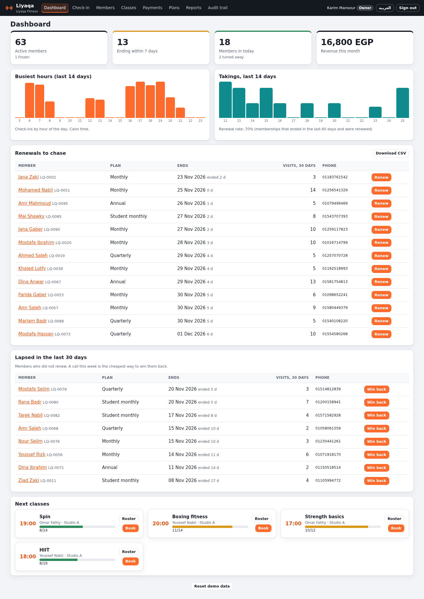
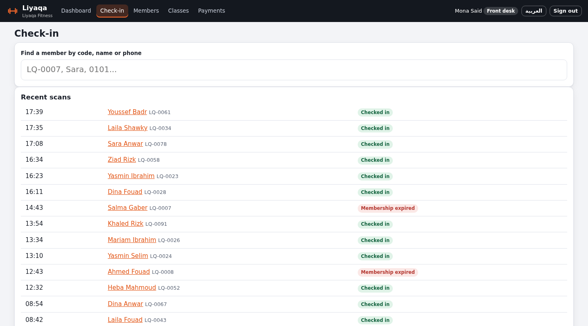
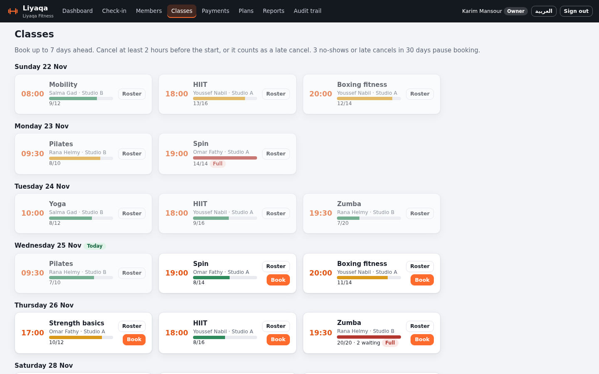
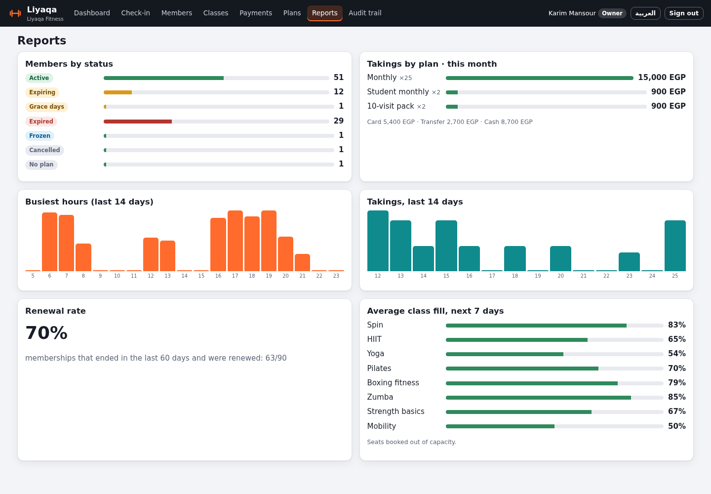
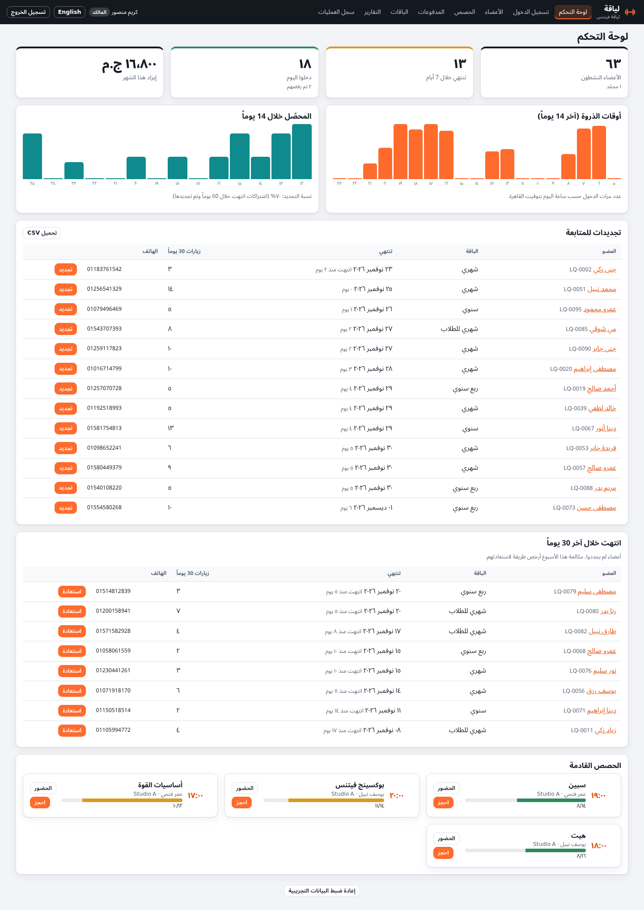

# Liyaqa (لياقة): gym membership management

A bilingual (Arabic RTL / English) system for a small gym: check-in desk, memberships and renewals, freezes, class booking with waitlists, trainer attendance, payments and receipts, and owner reports.

**Live demo:** https://liyaqa-gym.vercel.app
**Product direction, scope and delivery:** Nada Gamal.



## Try it

Open the demo and sign in with a PIN (the language button switches Arabic / English):

| Role | PIN |
| --- | --- |
| Owner (Karim Mansour) | 1111 |
| Front desk | 2222 |
| Trainer (Omar Fathy) | 3333 |
| Member (Hana Tarek) | 4444 |

The demo is seeded with 96 members, about 210 payments, about 690 check-ins and about 370 class bookings, all dated relative to now. "Reset demo data" on the dashboard restores the seed.

## What it does

- **Check-in desk.** Denies expired, frozen, cancelled, no-plan and no-visits members. A 2-day grace period lets the member in with a warning. A second scan within 2 hours is not counted twice. Visit packs lose one visit per counted check-in.
- **Plans and billing.** Monthly, quarterly, annual, student and a 10-visit pack. Renewing a running membership stacks after its current end date. 10% household discount on time-based plans. Numbered receipts. The owner can void the latest payment and edit plan prices.
- **Freeze.** 7 to 30 days, at most 30 days per 12 months. The end date moves out when the freeze ends.
- **Classes.** Booking up to 7 days ahead, a waitlist of 5 with automatic promotion, trainer attendance marking. A late cancel (under 2 hours) or a no-show counts as a strike, and 3 strikes in 30 days pause booking.
- **Owner reports.** Busiest hours, takings for 14 days, members by status, renewal rate, class fill rate, a renewals-to-chase list and a win-back list for lapsed members.
- **Also.** CSV export (formula characters neutralised), an audit trail, role-based views, a member portal for bookings and freezes.

All business rules live in `public/logic.js` and are shared by the browser and the API.

## Screenshots

| | |
| --- | --- |
|  |  |
|  |  |

Member portal in Arabic on a phone: `docs/member-portal-ar-mobile.png`.

## Honest limits

This is a working demo, not a production system.

- The PINs are public and there is no real authentication, password reset or per-gym accounts.
- State is held in server memory only. It resets about every 6 hours and whenever the serverless instance restarts. Nothing is stored in a database.
- No online payments. Payments are recorded by staff, and receipts are internal numbers, not tax invoices.
- No SMS, WhatsApp or email reminders. The renewal and win-back lists give staff the phone numbers to call.
- No door or turnstile hardware, and no QR or card reader: the desk looks members up by name, code or phone.
- Single gym, single time zone (Cairo). Sample names are invented.

## Tests

- `npm test`: 20 unit tests for the business rules (grace, double scan, packs, stacking, household discount, freeze limits, waitlist, strikes, voiding, CSV).
- `node e2e/e2e.mjs <url>`: 96 checks through the real API and a headless Chrome: auth and tampering, every role's permissions, desk decisions, billing, freezes, booking and waitlist, Arabic RTL, no page errors. Last run against the live URL: 96 passed, 0 failed. It resets the demo data when it finishes.
- `node e2e/shots.mjs <url>`: regenerates the screenshots in `docs/`.

## Run locally

```
npm install
./run-local.sh        # http://localhost:3100
npm test
```

## Layout

- `public/`: the static front end (`logic.js`, `app.js`, `i18n.js`, `style.css`)
- `api/`: one serverless function (`data.js`) and signed-token helper (`_auth.js`)
- `test/`, `e2e/`: unit and live tests

## Deploy

Static files plus one function on Vercel. Optionally set `LIYAQA_SECRET` to sign tokens with your own secret.
